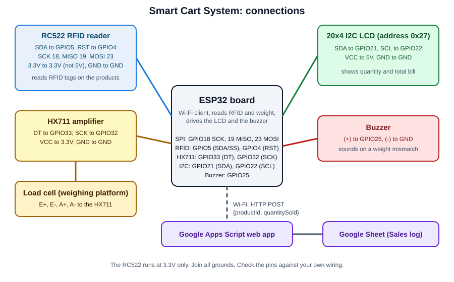

# Smart Cart System

A prototype smart shopping cart built on an ESP32. Each product carries an RFID tag. Scanning a tag adds the product to the bill on a 20x4 LCD. A load cell checks that the weight in the cart matches the scanned items. A buzzer warns when there is extra weight that was not scanned. Every scan is also logged to a Google Sheet.

**Status:** working prototype (built by the author).



## What it does

1. **Starts up:** the LCD shows "Initializing...". The ESP32 sets up the RFID reader and the load cell, sets the scale to zero (tare) and connects to Wi-Fi. When it is ready the LCD shows "Smart Cart Ready!".
2. **Identifies a product:** when an RFID tag touches the reader, the ESP32 reads its UID and looks it up in a list of five products.
3. **Updates the bill:** for a known product it adds that product's price and expected weight to the running totals and increases the item count. The LCD shows "Product Qty" and "Total Bill".
4. **Rejects unknown tags:** if the UID is not in the list the LCD shows "Unknown Product!" for one second.
5. **Logs the sale:** if Wi-Fi is connected the ESP32 sends the product number and a quantity of 1 to a Google Apps Script web app, which adds a row to a Google Sheet.
6. **Checks the weight:** the load cell is read continuously. If the weight changes by more than 5 units and the cart is heavier than the expected total by more than 10 units, the cart has extra unscanned weight. The buzzer sounds for 0.3 seconds and the LCD shows "Weight Mismatch!" for one second. Then the normal bill display returns.

## How the parts work together

```
RFID tag -> RC522 reader -> ESP32 -> LCD (quantity and bill)
                              |  \-> buzzer (weight mismatch)
Load cell -> HX711 --------> ESP32
                              |
                              +-- Wi-Fi --> Google Apps Script --> Google Sheet
```

## Components

The list below is taken from the code. Please check it against your own build.

| No. | Component | Quantity | Purpose |
|---|---|---|---|
| 1 | ESP32 development board | 1 | Controller with Wi-Fi |
| 2 | RC522 (MFRC522) RFID reader | 1 | Reads product tags |
| 3 | RFID tags or cards (13.56 MHz) | 5 | One per product |
| 4 | Load cell | 1 | Measures weight [write its rating, for example 5 kg] |
| 5 | HX711 load cell amplifier | 1 | Converts the load cell signal for the ESP32 |
| 6 | 20x4 I2C LCD | 1 | Shows quantity and total bill |
| 7 | Buzzer | 1 | Weight mismatch alarm [write the type, for example active 5V buzzer] |
| 8 | Jumper wires, breadboard | several | Connections |
| 9 | Power supply [USB or battery] | 1 | Powers the ESP32 |

## Connections

| Module | Module pin | ESP32 pin |
|---|---|---|
| RC522 RFID | SDA (SS) | GPIO5 |
| RC522 RFID | RST | GPIO4 |
| RC522 RFID | SCK | GPIO18 |
| RC522 RFID | MOSI | GPIO23 |
| RC522 RFID | MISO | GPIO19 |
| RC522 RFID | 3.3V and GND | 3.3V and GND |
| HX711 | DT (DOUT) | GPIO33 |
| HX711 | SCK | GPIO32 |
| HX711 | VCC and GND | 3.3V and GND |
| LCD (I2C) | SDA | GPIO21 |
| LCD (I2C) | SCL | GPIO22 |
| LCD (I2C) | VCC and GND | 5V and GND |
| Buzzer | (+) | GPIO25 |
| Buzzer | (-) | GND |

The load cell connects to the HX711 (E+, E-, A+ and A-). Match the wire colours of your own load cell. The RC522 must use 3.3V. Do not power it from 5V.

## Product list in the code

The sketch keeps a small product table. Replace it with your own products:

- `products[]` holds the expected weight and the price of each product.
- `productUIDs[]` holds the RFID tag UID of each product, in the same order.

Use `tools/ReadUID` to read the UID of each of your tags.

## Repository contents

```
smart-cart-system/
├── README.md                          Overview (this file)
├── BUILD_GUIDE.md                     Step-by-step build and setup guide
├── SmartCart_ESP32/
│   └── SmartCart_ESP32.ino            Main sketch
├── tools/
│   ├── Calibration_HX711/             Finds your load cell calibration factor
│   └── ReadUID/                       Reads the UID of an RFID tag
├── google-apps-script/
│   └── Code.gs                        Example script that logs sales to a sheet
└── images/                            Photos and diagrams
```

## Quick start

1. Wire the modules as shown above.
2. Follow [BUILD_GUIDE.md](BUILD_GUIDE.md) to install the libraries, calibrate the load cell and read your tag UIDs.
3. Create the Google Sheet and Apps Script, then paste its web app URL into the sketch.
4. Enter your Wi-Fi name and password, then upload the sketch.

## Photos and demo


[Add a link to your YouTube demo video here.]

## Known limits and ideas to improve it

These come from reading the code. They are good next steps for anyone who builds on this project.

- **Tag UIDs must be exact.** The sketch converts each byte to hex without a leading zero, so a byte such as `0x0F` becomes `f`. The `ReadUID` tool prints UIDs in the same way, so copy them from there. Digits and letters must match, for example the digit zero and not the letter O.
- **It only detects extra weight.** An unscanned item makes the cart heavier and triggers the alarm. Removing an item, or a scanned item that is missing, does not.
- **No remove, reset or checkout.** The totals only reset when the board restarts.
- **Wi-Fi is required at start.** The sketch waits for Wi-Fi and does not continue without it.
- **Logging status can be misleading.** "Data sent successfully!" prints for any HTTP reply code, including error codes. Check the Google Sheet to be sure the rows arrive.
- **The product table needs care.** Check that each weight and price matches its comment and its real product. Also check that the currency symbol on the LCD is the one you want.
- **The Apps Script web address is a secret.** Anyone who has it can add rows to your sheet. Do not publish it.

## What I learned

[Write one or two sentences, for example how a load cell and an HX711 measure weight, or how RFID tags identify products.]

## Tools

Arduino IDE, ESP32 Arduino core, libraries MFRC522, HX711 and LiquidCrystal_I2C, Google Sheets and Google Apps Script.

## Author

Mohammad Ullah, Electrical and Electronic Engineering, RUET
Portfolio: https://mohammadullah2eee.github.io
